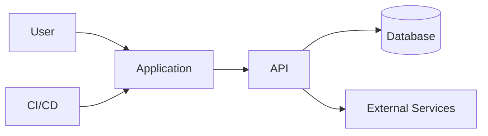

# System Architecture

## Purpose

This document describes the system from above: boundaries, components, interfaces, data flow, deployment, security, and operational characteristics.

## Architecture goals

- modularity;
- testability;
- clear ownership;
- low coupling;
- safe evolution;
- observable behavior;
- reproducible deployment.

## System context

## Components

| Component | Responsibility | Owns data | Public interface | Owner |
|---|---|---|---|---|
| Frontend | TBD | No | UI | TBD |
| API | TBD | No | HTTP/API | TBD |
| Domain | TBD | Domain rules | Internal | TBD |
| Persistence | TBD | Yes | Repository interfaces | TBD |

## Dependency rules

- UI may call application interfaces.
- Application may call domain services.
- Domain must not depend on UI, frameworks, or deployment tools.
- Infrastructure implements interfaces defined by inner layers.
- Cross-component calls require documented contracts.

## Data architecture

Document:

- entities;
- identifiers;
- ownership;
- retention;
- consistency model;
- migrations;
- backup and recovery;
- sensitive data classification.

## API rules

- version public APIs;
- validate all inputs;
- use consistent errors;
- document idempotency;
- define timeout and retry behavior;
- preserve backward compatibility or provide migration plans.

## Security baseline

- least privilege;
- secrets outside source control;
- dependency scanning;
- input validation;
- authorization at domain boundaries;
- audit logging for sensitive actions;
- explicit threat modeling for high-risk features.

## Observability

Every production component should expose:

- structured logs;
- health checks;
- meaningful metrics;
- correlation identifiers;
- trace context when applicable;
- actionable alerts.

## Architecture decisions

Important decisions must be recorded in `docs/05-decisions/` using the ADR template.
