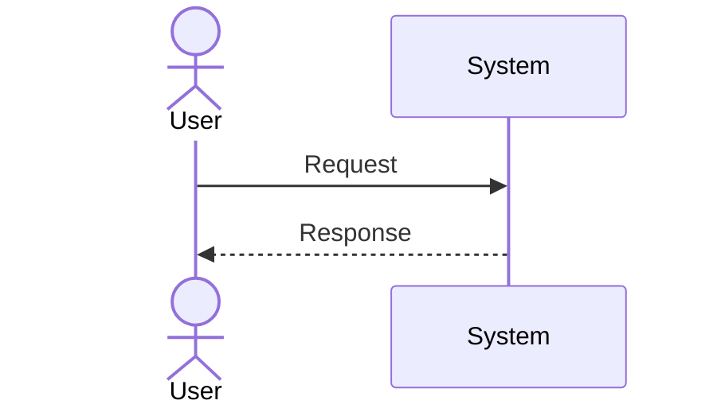

# FEATURE-XXX — Feature Name

## Status

Draft | Approved | In progress | Implemented | Deprecated

## Owner

TBD

## Purpose

Describe the user or system outcome.

## Context

Explain why the feature exists and how it fits the product.

## Scope

### Included

- TBD

### Excluded

- TBD

## Actors

- TBD

## Functional requirements

1. TBD

## Non-functional requirements

- performance:
- availability:
- security:
- accessibility:
- observability:
- compatibility:

## Interfaces

Describe API, events, CLI, UI, files, or integrations.

## Data

Describe entities, fields, validation, ownership, retention, and migration impact.

## Main flow

## Edge cases

- TBD

## Failure modes

| Failure | Detection | Behavior | Recovery |
|---|---|---|---|
| TBD | TBD | TBD | TBD |

## Security considerations

- authentication:
- authorization:
- validation:
- sensitive data:
- abuse cases:
- audit events:

## Observability

- logs:
- metrics:
- traces:
- alerts:

## Acceptance criteria

- [ ] TBD

## Test plan

- unit:
- integration:
- end-to-end:
- security:
- performance:

## Dependencies

- tasks:
- ADRs:
- components:
- external systems:

## Open questions

- TBD
